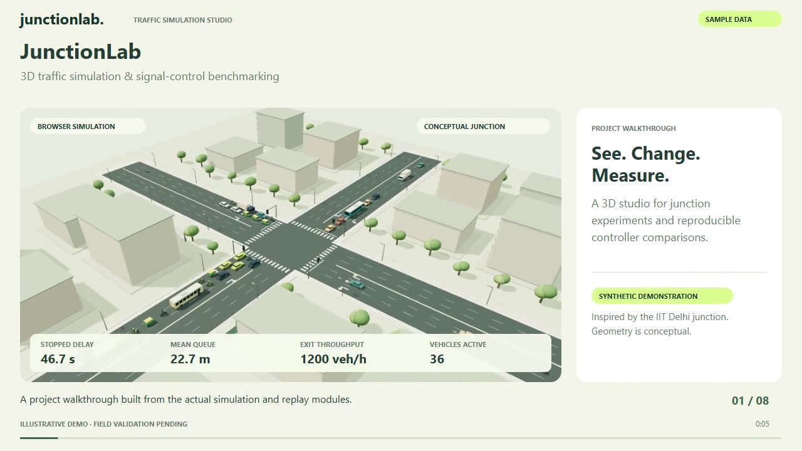
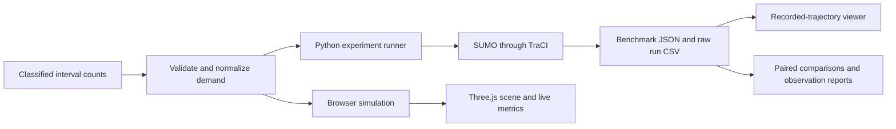

# JunctionLab

**Interactive 3D traffic simulation and reproducible signal-control experiments.**

[](https://github.com/Valomaxed/junctionlab/actions/workflows/ci.yml)
[](LICENSE)

JunctionLab explores how traffic demand and signal control affect queues, stopped delay, and throughput at a four-arm junction. It combines an interactive Three.js simulator with an offline Python/SUMO experiment pipeline and 3D trajectory replay. The study context is the IIT Flyover surface junction near IIT Delhi, New Delhi.

**Current evidence:** a working software prototype, 24 automated tests, and 15 native SUMO runs using synthetic demand and assumed geometry. Field counts have not yet been integrated; field calibration and independent validation are pending. These results demonstrate the experiment workflow, rather than measured improvements at the real junction.



[Study design](docs/RESEARCH.md) · [Results](docs/RESULTS.md)

## Project at a glance

| Question | Answer |
|---|---|
| What does it study? | Effects of demand, green allocation, and controller choice on one junction. |
| What can I interact with? | Demand, cycle length, N–S green allocation, cameras, vehicle inspection, and recorded native runs. |
| Which vehicles are represented? | Cars, motorcycles, auto-rickshaws, buses, and generic trucks. |
| Which native controllers are compared? | Fixed-time, custom actuated, and a constrained queue-pressure heuristic. |
| How are comparisons made? | Common scheduled arrivals within each paired seed, with per-run exports and paired uncertainty estimates. |
| What is not established? | Surveyed geometry, calibrated mixed-traffic behavior, or real-world delay/emissions savings. |

## Start in five minutes

Requires **Node.js 20.11+** and npm. Python and SUMO are optional for the browser demo.

```sh
git clone https://github.com/Valomaxed/junctionlab.git
cd junctionlab
npm ci
npm run build
npm run dev
```

Open **http://127.0.0.1:4173**.

1. Watch the live model and switch between orbit, top, and street cameras.
2. Change demand, cycle, or green allocation; inspect a vehicle's speed and stopped time.
3. Run the browser scenario comparison and export results.
4. Choose **Load SUMO demo** for native trajectories; switch controllers and scrub time.

The build vendors Three.js locally. An optional web font has a system-font fallback. CSV and replay-file parsing stay in the browser.

## Two execution paths

| | Interactive browser model | Native SUMO pipeline |
|---|---|---|
| Purpose | Immediate what-if exploration | Reproducible controller experiments |
| Engine | Custom fixed-step JavaScript kinematic model | Eclipse SUMO 1.24.0, controlled through TraCI |
| Execution | Browser; experiments use a Web Worker | Local Python command line |
| Comparisons | Four timing scenarios, three paired seeds | Fixed-time, actuated, queue-pressure; configurable paired seeds |
| Visualization | Live 3D vehicle motion | Replay of recorded native positions |
| Input changes | Restart the live model | Require a new offline run; replay sliders are locked |

These engines serve different purposes. A browser replay is not a live SUMO server, and using SUMO does not itself validate a model against field traffic.



## Included native benchmark

The saved experiment contains **3 controllers × 5 paired seeds = 15 runs**, with a 120-second warm-up and 300-second analysis per run. Demand schedules are shared by controllers within each seed. Replay shows the first seed; summaries use all five.

| Controller | Stopped delay, mean ± SD (s/arrival) | Mean queue, mean ± SD (m) | Throughput, mean ± SD (veh/h) |
|---|---:|---:|---:|
| Fixed-time | 56.2 ± 3.7 | 35.7 ± 1.4 | 1,644 ± 130 |
| Actuated | 33.9 ± 2.5 | 24.0 ± 2.7 | 1,766 ± 172 |
| Queue-pressure | 53.8 ± 6.1 | 40.3 ± 5.5 | 1,495 ± 102 |

These are **synthetic demonstration results**. SD describes variation across seeds, not a confidence interval. See [the results and paired intervals](docs/RESULTS.md), [raw runs](data/sumo-demo.runs.csv), and [complete benchmark](data/sumo-demo.json). Rankings are specific to this short example.

## Reproduce native experiments

Requires Python 3.10+. Pinned optional packages include SUMO binaries and use a local loopback connection for TraCI.

```sh
python -m venv .venv
```

Windows PowerShell:

```powershell
.venv\Scripts\python.exe -m pip install -r backend/requirements.txt
.venv\Scripts\python.exe backend/junctionlab.py run --input data/sample-counts.csv --output runs/example.json --work-dir runs/example-native --duration 300 --seeds 2026,2027,2028,2029,2030 --sample
```

macOS/Linux:

```sh
.venv/bin/python -m pip install -r backend/requirements.txt
.venv/bin/python backend/junctionlab.py run --input data/sample-counts.csv --output runs/example.json --work-dir runs/example-native --duration 300 --seeds 2026,2027,2028,2029,2030 --sample
```

Use a new, empty work directory for each experiment. Load `runs/example.json` with **Open SUMO results**. See [SUMO.md](docs/SUMO.md) for supplied networks, configuration, fitting, and held-out observation comparisons.

## Use field data

Export Excel to **CSV UTF-8**. Each row represents one interval, entry arm, movement, and vehicle type:

```csv
approach,count,interval_start,interval_minutes,movement,vehicle_type
S,41,08:30,15,L,motorcycle
S,96,08:30,15,T,motorcycle
S,22,08:30,15,R,motorcycle
```

These are **format examples**, not field observations. Counts are whole vehicles, not PCU or hourly rates. `N/S/E/W` identify the **entry arm**; a survey's **NB** traffic enters from **S**. Custom column names can be mapped in the browser.

Read the [data guide](docs/DATA.md) before importing lab counts. It covers approach mapping, supported classes, omitted-category handling, stop-line counts versus demand, and additional observations for validation. Importing counts is not completed calibration.

## Verify the software

With Node.js and Python installed:

```sh
npm ci
npm test
npm run test:backend
npm run build
npm run test:geometry
```

There are 16 JavaScript tests and 8 Python tests. Python unit tests use the standard library and do not require native SUMO. CI runs these checks on Linux and Windows; it does not certify field accuracy. Historical native and UI evidence is in [VERIFICATION.md](docs/VERIFICATION.md).

## Documentation and source map

| Resource | Contents |
|---|---|
| [Research overview](docs/RESEARCH.md) | Problem, objectives, method, evidence, and next milestones |
| [Data guide](docs/DATA.md) | CSV dictionary, lab-to-model mapping, and provenance |
| [Native results](docs/RESULTS.md) | Saved experiment, metrics, paired intervals, interpretation |
| [Browser model card](docs/MODEL.md) | Routes, vehicle assumptions, motion, signals, and metrics |
| [SUMO guide](docs/SUMO.md) | Controllers, native execution, fitting, validation commands |
| [Validation plan](docs/VALIDATION.md) | Field collection, calibration, independent evaluation |
| [Import reference](docs/IMPORT.md) | Detailed browser CSV format and constraints |
| `src/` | UI, simulator, Web Worker, renderer, and replay adapter |
| `backend/` | Native CLI, controller logic, and Python tests |
| `data/` | Labeled sample inputs, benchmark bundle, raw runs, observation template |
| `tests/`, `scripts/` | JavaScript tests, build, geometry check, local server |

## Limitations and next milestones

The network has three dedicated entry lanes per arm. The actual flyover, pedestrians, bus stops, browser lane-changing, and heterogeneous lateral driving are not modeled. Fuel and CO₂ are illustrative idle-only estimates. Queue-pressure is a constrained heuristic; no published optimality guarantee is claimed.

Next: integrate the classified turning-count survey, reconstruct observed lanes/phases, fit a small set of behavior parameters, and evaluate queues/discharge on an independent session. Bus priority and detector-error robustness are later extensions. This is an academic prototype, not deployed signal control.

## License and attribution

Original code and procedural vehicle models use the [MIT License](LICENSE). Dependency licenses remain their own; see [third-party notices](THIRD_PARTY_NOTICES.md). No student rosters, raw lab handouts, or private field records are included.

Maintained by [Valomaxed](https://github.com/Valomaxed). **Cite this repository** provides software attribution; it is not a peer-reviewed publication.
