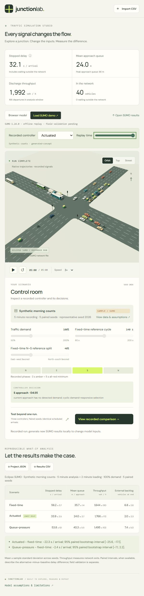

# JunctionLab

Interactive 3D junction simulation and reproducible signal-control experiments.

JunctionLab combines a browser traffic model with an offline Python/SUMO pipeline. It imports classified traffic counts, compares controllers, and replays recorded vehicle trajectories. The study context is the IIT Flyover surface junction near IIT Delhi; the included geometry and demand are synthetic.

[](https://github.com/Valomaxed/junctionlab/actions/workflows/ci.yml)
[](LICENSE)

## Application

<details open>
<summary>SUMO trajectory replay and controller results</summary>



</details>

The screenshot shows the supplied synthetic benchmark. Replay displays saved native trajectories; it does not run SUMO inside the browser.

## Features

- 3D vehicles, camera controls, vehicle inspection, and configurable signals/demand.
- CSV schema mapping and validation for interval, approach, turn, and vehicle class.
- Deterministic browser comparisons in a Web Worker.
- Native fixed-time, actuated, and constrained queue-pressure controllers through TraCI.
- Recorded trajectory/signal replay and exportable per-run metrics and paired intervals.

## Run the browser application

Requires Node.js 20.11+ and npm. Python/SUMO are optional for the browser model and supplied replay.

```sh
git clone https://github.com/Valomaxed/junctionlab.git
cd junctionlab
npm ci
npm run build
npm run dev
```

Open [localhost:4173](http://127.0.0.1:4173/). Import a CSV or select **Load SUMO demo**. The build vendors Three.js locally; CSV parsing stays in the browser.

## Saved native benchmark

Three controllers, five paired seeds, a 120 s warm-up, and a 300 s analysis period: **15 runs**. Controllers share the scheduled demand within each seed.

| Controller | Stopped delay (s/arrival) | Mean queue (m) | Throughput (veh/h) |
|---|---:|---:|---:|
| Fixed-time | 56.2 +/- 3.7 | 35.7 +/- 1.4 | 1,644 +/- 130 |
| Actuated | 33.9 +/- 2.5 | 24.0 +/- 2.7 | 1,766 +/- 172 |
| Queue-pressure | 53.8 +/- 6.1 | 40.3 +/- 5.5 | 1,495 +/- 102 |

Values are means +/- sample standard deviations across seeds. This short synthetic experiment demonstrates the workflow; it does not establish field performance. Paired bootstrap intervals and metric definitions are in [Results](docs/RESULTS.md), with [raw runs](data/sumo-demo.runs.csv) and the [replay bundle](data/sumo-demo.json).

## Native experiments and field data

Use Python 3.10+ in a virtual environment, then install `backend/requirements.txt`. The [SUMO guide](docs/SUMO.md) documents native execution, networks, parameter fitting, and observation comparisons.

```sh
python -m pip install -r backend/requirements.txt
python backend/junctionlab.py --help
```

The [data guide](docs/DATA.md) defines the import schema and survey-to-model mapping. Supplied count rows are examples, not observations. Field calibration and held-out queue/discharge validation remain pending.

## Verification

```sh
npm test
npm run test:backend
npm run build
npm run test:geometry
```

The repository has 16 JavaScript and 8 Python tests. CI runs tests, the static build, and vehicle-geometry checks on Windows and Linux. Software tests do not establish traffic-model accuracy. [Recorded verification](docs/VERIFICATION.md).

## Model scope

The network has three dedicated entry lanes per arm. The actual flyover, pedestrians, bus stops, and heterogeneous lateral driving are not represented. Queue-pressure is a constrained heuristic. Fuel/CO2 figures are illustrative idle-only estimates. The browser concept model and offline SUMO model have separate purposes and assumptions.

## Source and documentation

| Path | Contents |
|---|---|
| `src/` | Browser model, renderer, controls, Web Worker, and replay |
| `backend/` | SUMO runner, controllers, fitting, and unit tests |
| `data/` | Sample demand, raw runs, replay bundle, and observation template |
| `tests/`, `scripts/` | Tests, build, geometry checks, and local server |

[Research design](docs/RESEARCH.md) · [Browser model](docs/MODEL.md) · [CSV reference](docs/IMPORT.md) · [Validation plan](docs/VALIDATION.md) · [Contributing](CONTRIBUTING.md)

Original code and procedural models use the [MIT License](LICENSE). [Third-party notices](THIRD_PARTY_NOTICES.md) cover dependencies.
