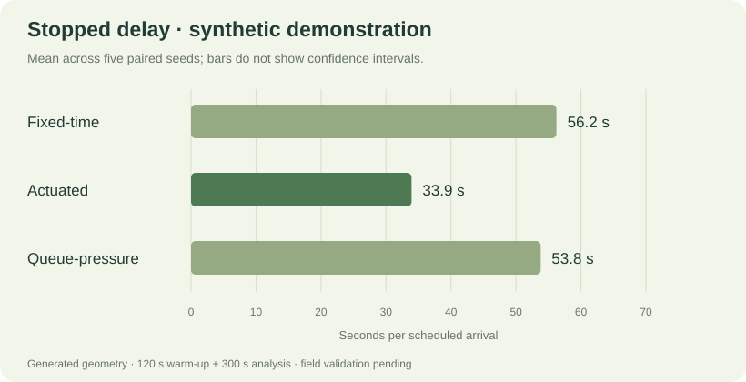

# Native benchmark results

**Synthetic demonstration only.** No result on this page is an observed improvement at the IIT Flyover junction. Demand, geometry, driver behavior, and reference signal settings are assumed. Field calibration and independent validation remain pending.

This page is generated from [the full bundle](../data/sumo-demo.json) by `npm run report`. The [raw per-run CSV](../data/sumo-demo.runs.csv) supports inspection of individual seeds, schedule hashes, counts, and unfinished demand.

## Experiment configuration

| Item | Value |
|---|---|
| Native engine | Eclipse SUMO 1.24.0 |
| Controllers | Fixed-time, custom actuated, constrained queue-pressure |
| Seeds | 2026, 2027, 2028, 2029, 2030 |
| Runs | 3 controllers × 5 paired seeds = 15 |
| Warm-up | 120 s |
| Analysis | 300 s |
| Reference timing | Nominal 140 s cycle; N/S combined allocation 40% |
| Geometry | Generated concept; dedicated left/through/right entry lanes |
| Demand source | Synthetic 15-minute counts; analysis uses its first five minutes |
| Trajectory replay | Representative seed 2026; summaries use every seed |

The same scheduled arrival file is reused for every controller within a seed. SUMO's subsequent behavior can respond differently to each signal strategy. Minimum clearance plus internal-link guards can lengthen the effective fixed-time cycle.

## Aggregate outcomes

Values are **mean ± sample standard deviation across seeds**, not confidence intervals.

| Controller | Stopped delay (s/arrival) | Mean approach queue (m) | Network-exit throughput (veh/h) | External backlog at end (vehicles) |
|---|---:|---:|---:|---:|
| Fixed-time | 56.2 ± 3.7 | 35.7 ± 1.4 | 1644 ± 130 | 6.8 ± 2.8 |
| Actuated | 33.9 ± 2.5 | 24.0 ± 2.7 | 1766 ± 172 | 2.0 ± 2.3 |
| Queue-pressure | 53.8 ± 6.1 | 40.3 ± 5.5 | 1495 ± 102 | 7.4 ± 5.0 |

## Paired stopped-delay differences

Each seed supplies an alternative-minus-fixed-time difference. The interval is a percentile bootstrap with 4,000 resamples and bootstrap seed 702. Negative values favor the alternative for this metric in this example. With five pairs, this is a demonstration of the method; input/model uncertainty is not included.

| Comparison | Mean difference (s/arrival) | Paired 95% bootstrap interval |
|---|---:|---:|
| Actuated − fixed-time | -22.3 | [-25.6, -17.1] |
| Queue-pressure − fixed-time | -2.4 | [-7.1, 2.2] |

Actuated control has lower stopped delay in this saved example. The queue-pressure delay interval spans zero, and its queue and throughput outcomes do not support a general superiority claim. Do not select an intervention using delay alone or extrapolate this short synthetic comparison to the field site.

## Metric definitions

- **Stopped delay:** analysis-window vehicle-seconds below 0.5 m/s, including waiting for insertion, divided by scheduled analysis-window arrivals. Includes unfinished traffic and warm-up carryover stopped during analysis. It is not completed-trip mean delay.
- **Mean queue:** longest stopped tail on each entry arm, averaged over arms and time. Queues beyond finite links are tracked as separate external backlog.
- **Throughput:** network exits during analysis, expressed per hour. Warm-up carryover may contribute exits; this is not identical to stop-line discharge.
- **External backlog:** vehicles still waiting to enter at the end. Compare it with active vehicles and arrival/departure counts.
- **Fuel/CO₂:** only illustrative idle estimates (0.8 L/vehicle-hour; 2.31 kg/L), not a calibrated fleet-emissions model.

See [SUMO.md](SUMO.md) for controller logic, observation-boundary alignment, and exact commands; [RESEARCH.md](RESEARCH.md) for the field-study plan.
